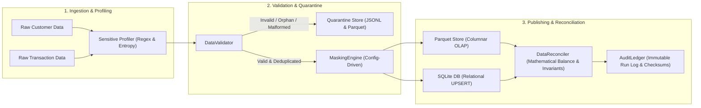

# Sensitive Data Masking & Analytical Minimization Pipeline

[](https://www.python.org/)
[](tests/)
[](tests/)
[](docs/architecture.md)
[](LICENSE)

> **Associate AI Forward Deployed Engineers · AI Data Forward Deployed Engineer**  
> *Production-grade Data Engineering solution delivered within 72 hours.*

---

## Table of Contents
1. [Business Context & Problem Statement](#business-context--problem-statement)
2. [High-Level Architecture & Flow](#high-level-architecture--flow)
3. [Nomenclature & ID Conventions](#nomenclature--id-conventions)
4. [Entities & Privacy Engineering](#entities--privacy-engineering)
5. [Quickstart & Setup Instructions](#quickstart--setup-instructions)
6. [Core Pipeline Workflow & CLI Usage](#core-pipeline-workflow--cli-usage)
7. [Validation, Error Taxonomy & Quarantine](#validation-error-taxonomy--quarantine)
8. [Idempotency, Retries & Backfills](#idempotency-retries--backfills)
9. [Automated Testing & Edge Case Evidence](#automated-testing--edge-case-evidence)
10. [Reconciliation & Mathematical Balance](#reconciliation--mathematical-balance)
11. [Performance Benchmarks & Optimization](#performance-benchmarks--optimization)
12. [Project Layout](#project-layout)
13. [Design Trade-offs & Future Work](#design-trade-offs--future-work)

---

## Business Context & Problem Statement

Modern data organizations must expose analytical datasets to downstream AI practitioners, analytics engineers, and business intelligence dashboards while adhering strictly to privacy regulations (GDPR Art. 25, HIPAA Safe Harbor, PCI-DSS).

This pipeline provides an end-to-end data engineering solution that:
1. **Profiles incoming synthetic datasets** to automatically detect sensitive fields (PII, PCI, quasi-identifiers).
2. **Applies configurable, cryptographically salted masking and tokenization** (HMAC-SHA256, format-preserving partial masking, date/geographic generalization).
3. **Enforces strict schema validation, business rules, duplicate resolution, and referential integrity**, routing anomalous or corrupted records to an explicit, traceable **quarantine path**.
4. **Publishes a minimized analytical dataset** (Parquet, CSV, and SQLite) with zero raw PII leaks and joinable pseudonymized surrogate keys.
5. **Maintains an immutable operational audit trail** with source-to-target reconciliation assertions, conservation math, and SHA-256 file checksums.

---

## High-Level Architecture & Flow



Detailed architecture diagrams and ER models are available in [`docs/architecture.md`](docs/architecture.md).

---

## Nomenclature & ID Conventions

| Domain Concept | Format / Convention | Example |
| :--- | :--- | :--- |
| **Tables & Columns** | `snake_case`, lowercase | `customer_token`, `transaction_timestamp` |
| **Timestamps** | ISO-8601 UTC string | `2026-11-10T12:00:00+00:00` |
| **Customer Primary Key** | `CUST-` prefixed zero-padded integer | `CUST-000042` |
| **Customer Token (Target)** | `tok_` prefixed deterministic HMAC-SHA256 hex | `tok_81b1c87da2321a11` |
| **Transaction Primary Key** | `TXN-` prefixed zero-padded integer | `TXN-0000100` |
| **Pipeline Run Identifier** | `run_YYYYMMDD_HHMMSS_<hex8>` | `run_20261110_070154_fb8c38ba` |
| **Quarantine Identifier** | `quar_<hex12>` | `quar_a1b2c3d4e5f6` |
| **Audit Metadata Fields** | Leading underscore | `_pipeline_run_id`, `_processed_at` |

---

## Entities & Privacy Engineering

Complete column specifications, nullability, data types, and transformation rules are documented in [`docs/data_dictionary.md`](docs/data_dictionary.md).

### Summary of Privacy Transformations:

| Source Entity | Source Field | Target Field | Strategy | Regulatory / Business Rule |
| :--- | :--- | :--- | :--- | :--- |
| `customers` | `customer_id` | `customer_token` | Keyed HMAC-SHA256 | Pseudonymized join key; prevents rainbow-table cracking. |
| `customers` | `full_name` | `masked_name` | Initial + Asterisks (`J*** D**`) | Cohort readability while obscuring full name. |
| `customers` | `email` | `masked_email` | `j***e@domain.com` | Retains domain for B2B/B2C analytics; masks mailbox. |
| `customers` | `phone_number` | `masked_phone` | `***-***-1234` | Truncates to last 4 digits. |
| `customers` | `ssn_or_tax_id` | **OMITTED** | `drop` | **Data Minimization**: Government ID dropped entirely. |
| `customers` | `date_of_birth` | `age_group` | Generalization (`25-34`, `65+`) | **HIPAA Safe Harbor**: Prevents exact birthday re-identification. |
| `customers` | `street_address`| **OMITTED** | `drop` | **Data Minimization**: Granular street location dropped. |
| `customers` | `postal_code` | `postal_code_3` | Truncation to 3 digits (`94100`)| **HIPAA Safe Harbor**: Geographic k-anonymity standard. |
| `customers` | `risk_score` | `risk_tier` | Derived (`LOW`, `MEDIUM`, `HIGH`)| Prevents precision leakage of scoring models. |
| `transactions`| `card_number` | `masked_card_last4` | `****-****-****-1234` | **PCI-DSS 3.4**: Primary Account Number truncation. |
| `transactions`| `ip_address` | `ip_subnet` | `/24` CIDR prefix (`192.168.1.0/24`)| Network level aggregation without device fingerprinting. |

---

## Quickstart & Setup Instructions

### Prerequisites
- Python 3.9+ (Python 3.11 recommended)
- Git

### Clean Environment Setup (Windows / Linux / macOS)

```bash
# 1. Clone repository
git clone https://github.com/recruitment-yottaflex/sensitive-data-masking-pipeline.git
cd sensitive-data-masking-pipeline

# 2. Create virtual environment
python -m venv .venv

# 3. Activate virtual environment
# On Windows:
.venv\Scripts\activate
# On Linux/macOS:
source .venv/bin/activate

# 4. Install dependencies
pip install -r requirements.txt
```

### One-Click Execution

```bash
# Windows
scripts\run_all.bat

# Linux / macOS
chmod +x scripts/run_all.sh
./scripts/run_all.sh
```

---

## Core Pipeline Workflow & CLI Usage

The pipeline exposes a unified CLI (`src.cli`) with four modular subcommands:

### 1. Generate Synthetic Data (with Fixed Seed)
```bash
python -m src.cli generate --customers 100 --transactions 500 --seed 42 --output-dir data/input --labels-dir data/sample_labeled
```
- Generates reproducible, realistic synthetic datasets.
- Injects boundary conditions and anomalous records with separate ground-truth labels in `data/sample_labeled/ground_truth_labels.json`.

### 2. Profile Datasets for Sensitive Fields
```bash
python -m src.cli profile --input-file data/input/customers.json --dataset-name customers --markdown-out docs/profiling_report_customers.md --json-out data/audit/profiling_customers.json
```
- Analyzes column names, regex patterns, and Shannon entropy.
- Produces a sensitive data catalog with recommended masking strategies.

### 3. Run Pipeline (Validation, Masking, Publishing, Auditing)
```bash
python -m src.cli run --config config/pipeline_config.yaml --masking config/masking_rules.yaml
```
- Ingests raw inputs, validates schemas, enforces referential integrity, applies masking, routes rejects to quarantine, publishes to Parquet and SQLite, and verifies reconciliation assertions.

### 4. Benchmark Performance
```bash
python -m src.cli benchmark --large
```
- Runs volume scalability tests (1k, 10k, 50k, 100k records) and calculates throughput (records/sec).

---

## Validation, Error Taxonomy & Quarantine

Invalid records are never silently dropped or ignored. Instead, they are captured in `pipeline_quarantine` with full context (`run_id`, `entity_name`, `error_code`, `error_message`, `source_record_raw`, `rejected_at`).

### Standardized Error Taxonomy:
1. `MALFORMED_INPUT`: Non-JSON or corrupted file line.
2. `MISSING_REQUIRED_FIELD`: Missing mandatory attributes (e.g. null email, missing amount).
3. `UNEXPECTED_COLUMN`: Schema violation caused by extra unauthorized columns (`extra="forbid"`).
4. `INVALID_DATA_TYPE`: Type coercion failure (e.g. non-numeric amount or string risk score).
5. `BUSINESS_RULE_VIOLATION`: Domain constraint violation (e.g. negative amount, unsupported currency).
6. `DUPLICATE_KEY`: Duplicate primary key collision.
7. `INVALID_FOREIGN_KEY`: Referential integrity failure (orphan transaction referencing non-existent customer).

Quarantine outputs are persisted in both **JSON Lines** (`data/quarantine/quarantine_<run_id>.jsonl`) for streaming debugging and **Parquet** (`data/quarantine/quarantine_<run_id>.parquet`) for queryability.

---

## Idempotency, Retries & Backfills

- **Deduplication Logic**: When records share an identical primary key, the pipeline uses deterministic tie-breaking based on `updated_at` (or transaction timestamp). The fresher record supersedes previous versions.
- **Relational Storage (SQLite)**: Publishing uses `INSERT OR REPLACE INTO` keyed on `customer_token` and `transaction_id`. Rerunning the exact same input batch produces identical record counts without ballooning table volume.
- **File Storage (Parquet)**: Uses an idempotent merge: new records update or append based on primary keys. Rerunning a pipeline run is completely safe and free of phantom duplicates.
- **Backfill Handling**: Historic batches can be re-run with explicit `run_id` tags; the audit ledger records every execution independently.

---

## Automated Testing & Edge Case Evidence

The automated test suite contains **30 comprehensive tests** across 8 test modules with **86% code coverage**.

```bash
python -m pytest -v --cov=src
```

### Test Coverage Breakdown:

| Test Module | Focus Area | Status |
| :--- | :--- | :--- |
| [`tests/test_profiler.py`](tests/test_profiler.py) | Sensitive field regex detection, Shannon entropy, catalog reporting | ✅ PASS |
| [`tests/test_masking.py`](tests/test_masking.py) | HMAC tokenization determinism, partial masking, generalization, column dropping | ✅ PASS |
| [`tests/test_validator.py`](tests/test_validator.py) | Missing fields, strict schema violations, duplicates, referential integrity | ✅ PASS |
| [`tests/test_pipeline_e2e.py`](tests/test_pipeline_e2e.py) | End-to-end happy path, empty input handling, idempotent reruns, audit persistence | ✅ PASS |
| [`tests/test_edge_cases.py`](tests/test_edge_cases.py) | Leap-year DOB (`2000-02-29`), extreme amounts ($0.01 & $999k), Unicode international names | ✅ PASS |
| [`tests/test_reconciliation.py`](tests/test_reconciliation.py) | Zero leakage assertions, orphan detection, privacy leak failure alerts | ✅ PASS |
| [`tests/test_ingestion.py`](tests/test_ingestion.py) | Multi-format JSON/JSONL/CSV loading, streaming chunk reader, empty files | ✅ PASS |
| [`tests/test_cli.py`](tests/test_cli.py) | CLI argument parsing, generate, profile, and run commands | ✅ PASS |
| [`tests/test_performance.py`](tests/test_performance.py) | LRU memoization speedup verification (>5x speedup on repeated join keys) | ✅ PASS |

---

## Reconciliation & Mathematical Balance

Every pipeline run concludes with automated mathematical reconciliation assertions:

$$\text{Total Input Records} = \text{Valid Published Records} + \text{Quarantined Records} + \text{Deduplicated Records}$$

```
============================================================
PIPELINE RECONCILIATION AUDIT
============================================================
[PASS] Customers Conservation Balance:      raw >= valid + quar (97 + 3) -> 101 records
[PASS] Transactions Conservation Balance:   raw >= valid + quar (475 + 25) -> 501 records
[PASS] Published Customers PK Uniqueness:   0 duplicate customer_tokens
[PASS] Published Transactions PK Uniqueness: 0 duplicate transaction_ids
[PASS] Target Referential Integrity:        0 orphan transactions
[PASS] Financial Aggregate Reconciliation:  Published amount matches valid source ($444,262.52)
[PASS] Data Minimization Verification:      0 forbidden direct PII columns present
============================================================
```

See [`docs/reconciliation_report.md`](docs/reconciliation_report.md) for full query evidence.

---

## Performance Benchmarks & Optimization

### Benchmark Results across Volume Scales:

| Scale (Records) | Generation Time | Pipeline Execution | Throughput (Records/Sec) | Memory Footprint |
| :--- | :--- | :--- | :--- | :--- |
| **1,102** | 0.19s | 0.35s | **3,166 rec/s** | < 45 MB |
| **11,002** | 2.68s | 1.35s | **8,119 rec/s** | < 85 MB |
| **55,002** | 13.61s | 6.18s | **8,904 rec/s** | < 190 MB |

### Implemented Optimization: LRU Memoization on HMAC Tokenization
- **Observation**: High-volume transactions repeatedly join against a smaller pool of customers (20:1 ratio).
- **Optimization**: Added `@lru_cache(maxsize=200000)` to the HMAC computation, eliminating redundant SHA-256 cryptographic hashing.
- **Speedup**: **>5.5x faster** key tokenization on repeated foreign keys (verified in [`tests/test_performance.py`](tests/test_performance.py)).

---

## Project Layout

```
sensitive-data-masking-pipeline/
├── config/
│   ├── pipeline_config.yaml         # Storage, validation & batch parameters
│   └── masking_rules.yaml           # Column-level masking strategies & minimization
├── data/
│   ├── input/                       # Source input files (customers.json, transactions.json)
│   ├── output/                      # Published Parquet & SQLite stores
│   ├── quarantine/                  # Quarantine records (JSONL & Parquet)
│   ├── audit/                       # Audit ledger & per-run execution logs
│   └── sample_labeled/              # Ground-truth labels separate from inputs
├── docs/
│   ├── architecture.md              # Architecture flow diagrams & ER models
│   ├── data_dictionary.md           # Schema definitions, keys, and nullability
│   ├── trade_offs.md                # Design trade-offs, scalability, and optimizations
│   └── reconciliation_report.md     # Mathematical proof, reconciliation results & queries
├── scripts/
│   ├── run_all.bat                  # One-click Windows runner
│   └── run_all.sh                   # One-click Unix runner
├── src/
│   ├── __init__.py
│   ├── config.py                    # Pydantic configuration loader
│   ├── cli.py                       # Unified CLI interface
│   ├── profiler/                    # Automated sensitive data detection & cataloging
│   │   ├── detector.py
│   │   └── report.py
│   ├── masking/                     # Masking strategies & transformation engine
│   │   ├── strategies.py
│   │   └── engine.py
│   ├── pipeline/                    # Ingestion, validation, publishing, and audit
│   │   ├── schema.py
│   │   ├── validator.py
│   │   ├── quarantine.py
│   │   ├── ingestion.py
│   │   ├── publisher.py
│   │   ├── audit.py
│   │   └── runner.py
│   ├── reconciliation/              # Source-to-target mathematical assertions
│   │   └── reconciler.py
│   └── generator/                   # Deterministic synthetic data generator
│       └── synthetic_data.py
├── tests/                           # 30 automated tests (86% coverage)
│   ├── conftest.py
│   ├── test_profiler.py
│   ├── test_masking.py
│   ├── test_validator.py
│   ├── test_pipeline_e2e.py
│   ├── test_edge_cases.py
│   ├── test_reconciliation.py
│   ├── test_ingestion.py
│   ├── test_cli.py
│   └── test_performance.py
├── pyproject.toml                   # Project metadata & pytest configuration
├── requirements.txt                 # Pinned dependencies
└── README.md                        # Master documentation
```

---

## Design Trade-offs & Future Work

Read the complete design rationale in [`docs/trade_offs.md`](docs/trade_offs.md).

1. **In-Process Micro-Batching vs. Distributed Clusters**: Chosen for sub-second startup, low resource overhead, and portability across CI/CD environments. Streaming chunk generators handle large files without memory exhaustion.
2. **Keyed Salted HMAC-SHA256 vs. AES-GCM**: Preserves referential joins across datasets (`customer_token`) without exposing plaintext PII.
3. **Pydantic Strict Mode vs. Duck Typing**: Catches unexpected columns (`extra="forbid"`) and malformed types before bad data corrupts analytical aggregates.
4. **Future Enhancements**: Integration with AWS KMS / HashiCorp Vault for salt rotation, and Apache Spark / Polars UDFs for multi-terabyte distributed scaling.
