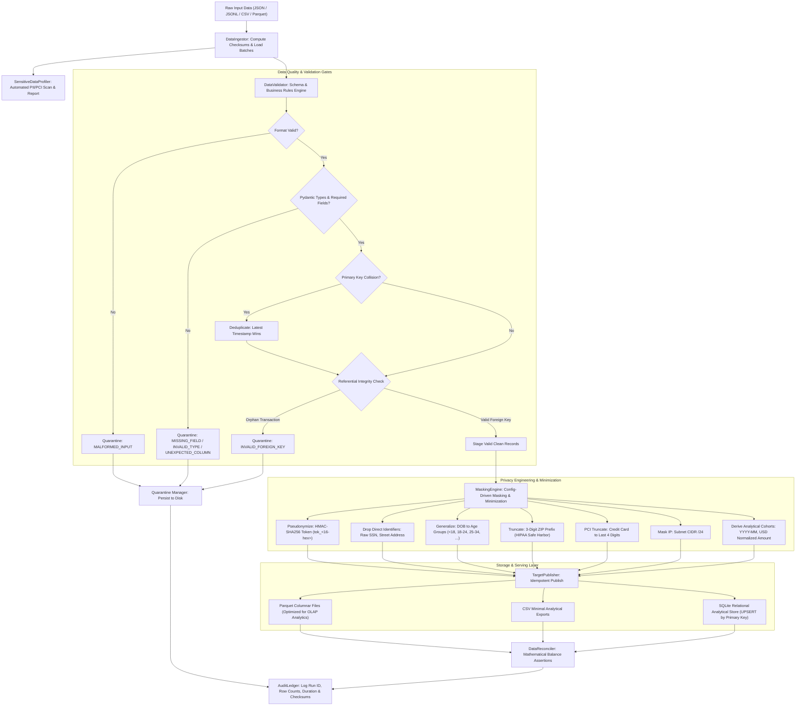
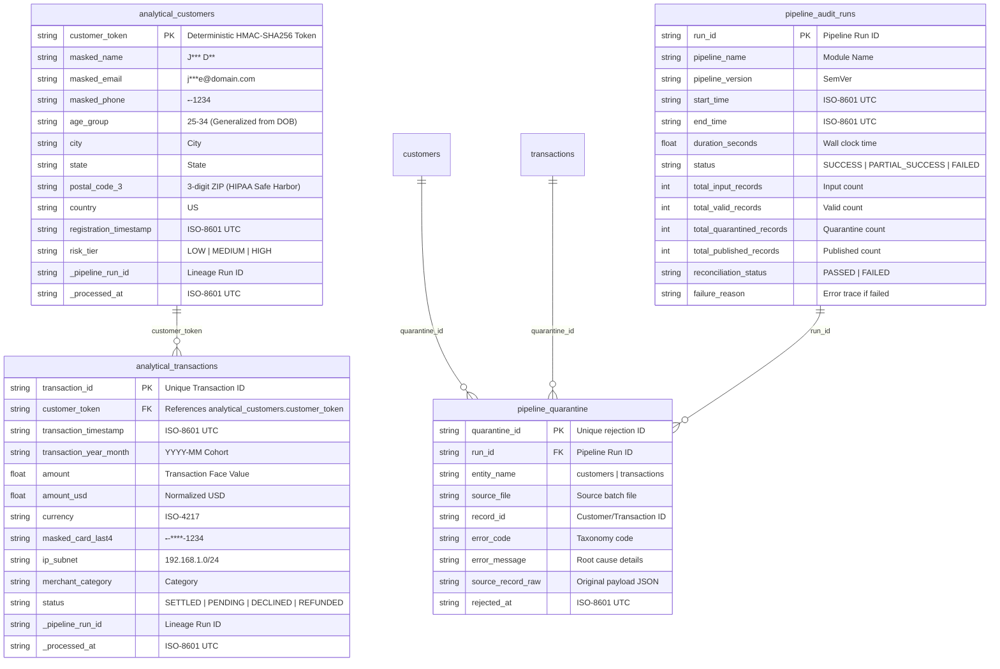

# Architecture & Data Flow Design

## 1. System Overview

The **Sensitive Data Masking and Analytical Minimization Pipeline** is designed to profile arbitrary synthetic incoming datasets, identify direct and quasi-identifiers, apply cryptographically secure masking and tokenization, and publish a minimized analytical dataset with complete auditability, zero data leakage, and idempotent rerun guarantees.

```
+--------------------------------------------------------------------------------------------------------+
|                                  DATA ENGINEERING PIPELINE ARCHITECTURE                                |
+--------------------------------------------------------------------------------------------------------+

 [Source Feeds]             [Ingestion & Profiling]            [Validation Layer]             [Target Storage]
 +---------------+          +----------------------+          +-------------------+          +------------------+
 | Customers     | -------->| DataIngestor         | -------->| Pydantic Schema   | -------->| MaskingEngine    |
 | (JSON/CSV)    |          | (Multi-format,       |          | - Missing fields  |          | (HMAC-SHA256,    |
 +---------------+          |  streaming chunks)   |          | - Type checking   |          |  Redaction,      |
                            +----------------------+          | - Business rules  |          |  Generalization, |
 [Source Feeds]             +----------------------+          | - Deduplication   |          |  Minimization)   |
 +---------------+          | SensitiveProfiler    |          +---------+---------+          +--------+---------+
 | Transactions  | -------->| (Regex, Entropy,     |                    |                             |
 | (JSON/CSV)    |          |  PII/PCI Catalog)    |                    | Rejects                     |
 +---------------+          +----------------------+                    v                             v
                                                              +-------------------+          +------------------+
                                                              | QuarantineStore   |          | TargetPublisher  |
                                                              | (JSONL & Parquet  |          | (Parquet, CSV,   |
                                                              |  Traceability)    |          |  SQLite UPSERT)  |
                                                              +-------------------+          +--------+---------+
                                                                                                      |
                                                              [Reconciliation & Audit]                v
                                                              +-------------------------------------------------+
                                                              | DataReconciler: Conservation, PK & FK Assertions|
                                                              | AuditLedger: Run Metrics, Checksums, Provenance |
                                                              +-------------------------------------------------+
```

---

## 2. Pipeline Execution Flow



---

## 3. Entity-Relationship Model



---

## 4. Privacy Engineering Principles

1. **GDPR Article 25 (Data Protection by Design and by Default)**:
   - Direct identifiers like SSN and full street addresses are systematically dropped from analytical tables rather than simply obfuscated.
   - Pseudonymized tokens (`customer_token`) use a secret cryptographic salt, preventing dictionary attacks while allowing analytical joins.
2. **HIPAA Safe Harbor Standard (45 CFR § 164.514(b)(2))**:
   - Dates of birth are bucketed into generalized demographic age categories (`<18`, `18-24`, `25-34`, `35-49`, `50-64`, `65+`), preventing re-identification via voter records.
   - ZIP codes are truncated to 3 digits (`postal_code_3`), satisfying the Safe Harbor geographic threshold.
3. **PCI-DSS Requirement 3.4**:
   - Primary Account Numbers (PANs) are strictly masked; only the last 4 digits are retained in target stores. Raw card numbers are never written to downstream analytical tables or logs.
4. **Zero Plaintext Leak Invariant**:
   - Automated reconciliation checks guarantee that zero raw direct identifiers are present in published target schemas. If any forbidden column is detected, the reconciliation assertion fails immediately.

---

## 5. Idempotency & Safe Reruns

- **Deduplication Strategy**: When duplicate primary keys are encountered, the pipeline uses deterministic tie-breaking based on `updated_at` (or transaction timestamp). The fresher record is preserved.
- **Atomic UPSERT**: Publishing to SQLite uses `INSERT OR REPLACE INTO` keyed by primary keys (`customer_token` and `transaction_id`).
- **Parquet Idempotent Overwrite / Merge**: Target Parquet files undergo an idempotent merge: new batches overwrite older records with identical primary keys, guaranteeing that rerunning the exact same input batch produces identical record counts without phantom duplicate rows.
